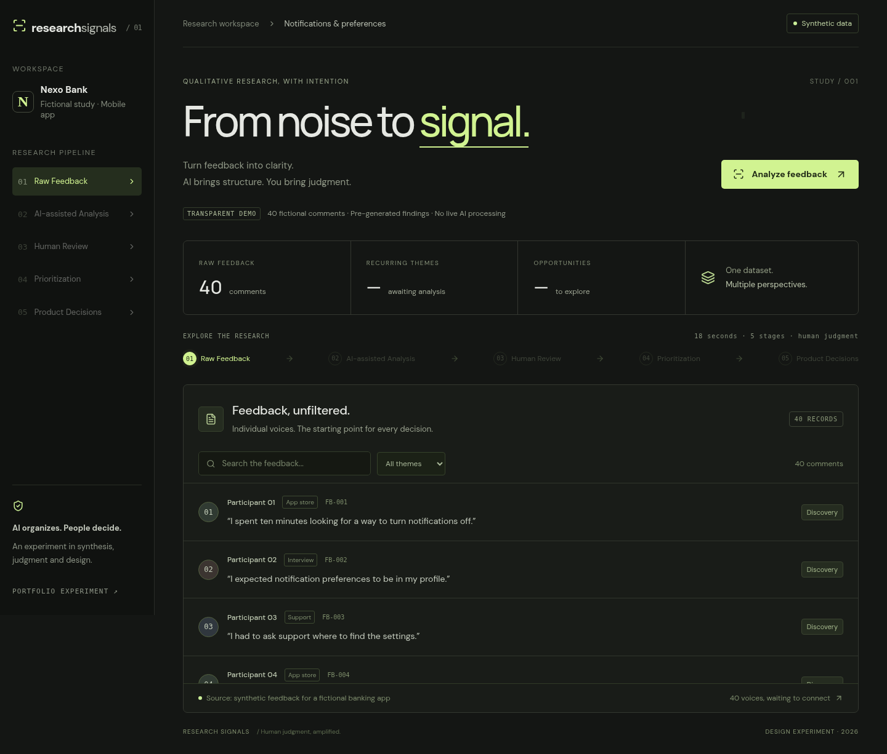
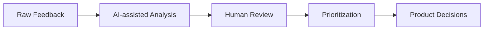

<div align="center">

# Research Signals

### From noise to signal.

A product design experiment in turning qualitative feedback into clearer product decisions—with human judgment at every step.

**React · TypeScript · Vite · Motion · Human review**

[Explore the prototype](https://research-signals-design.lilacgoby9.chatgpt.site) · [Getting started](#getting-started) · [The research flow](#the-research-flow)

*The hosted prototype is private and requires the owner's access.*

</div>



> **Transparent by design:** all 40 comments, participants, the bank, ratings and findings are fictional. Analysis uses pre-generated results. No live AI model is running.

## Why this exists

Large volumes of qualitative feedback can hide the patterns that matter. Research Signals explores how a Product Designer could use AI-assisted synthesis to organize evidence, challenge interpretations and identify product opportunities—while keeping people responsible for the decisions.

The fictional study focuses on notifications and preferences in a mobile banking app: discoverability, granular control, unclear message status, accessibility and irrelevant alerts.

## The research flow



| Stage | What you can explore |
| --- | --- |
| **Raw Feedback** | Browse 40 synthetic comments, search the dataset and filter by theme. |
| **AI-assisted Analysis** | Explore five pre-generated themes, mention counts and linked evidence. |
| **Human Review** | Accept a suggestion, edit its title or discard it before prioritization. |
| **Prioritization** | Compare recurrence, user impact and technical feasibility; adjust ratings. |
| **Product Decisions** | Review up to three opportunities with a problem, evidence, expected impact and product direction. |

Only accepted or edited themes enter the manual ranking. Pending and discarded suggestions are excluded. If fewer than three themes are validated, fewer opportunities are shown.

## Designed to be seen

A dark editorial interface, locally bundled typography and a short, choreographed walkthrough make the prototype suitable for a portfolio or screen recording.

- A soft headline entrance introduces the story.
- Forty visual points connect into five themes during analysis.
- Prioritization uses sorting lanes and growing comparison bars.
- Product decisions branch into three paths and reveal the opportunity cards.
- Subtle hover and confirmation feedback support interaction.
- Reduced-motion preferences disable animations and smooth scrolling.

### Record a walkthrough

Click **Analyze feedback**. The five stages unfold over **18 seconds**. Record for **20–25 seconds** to include the final reveal. Use **Pause walkthrough** or navigate to a stage to stop playback; click the analysis button to replay.

After playback, choose **Review decisions** to try the human review workflow yourself.

## Getting started

**Requirements:** Node.js 20.19+ or 22.12+, and npm.

```bash
git clone https://github.com/AndrezzaNascimento6/research-signals.git
cd research-signals
npm ci
npm run dev
```

Open the Local URL printed by Vite, usually `http://localhost:5173`.

| Command | Purpose |
| --- | --- |
| `npm run dev` | Start the development server. |
| `npm run build` | Check TypeScript and create the production build in `dist/`. |
| `npm run preview` | Serve the production build locally. |

## How prioritization works

```text
Score = 100 × (
  0.40 × mentions / 10
  + 0.40 × impact / 5
  + 0.20 × feasibility / 5
)
```

Impact and feasibility are rated from **1 to 5**; 5 means highest impact or most feasible. Ten is the largest mention count in this dataset. Ties preserve the original theme order.

These weights and initial ratings are illustrative, not a real engineering estimate. Accessibility remains a requirement across opportunities, regardless of rank. Product directions are hypotheses to validate through research and engineering—not proven business outcomes.

## Project structure

```text
research-signals/
├── src/
│   ├── main.tsx         # React interface, review state and walkthrough
│   ├── data.ts          # Synthetic comments, themes and scoring
│   └── style.css        # Responsive styling and motion choreography
├── docs/preview.png     # Workspace preview
├── .openai/hosting.json # Existing Sites deployment configuration
├── index.html
├── package.json
└── tsconfig.json
```

## Scope & validation

This is a browser-only prototype. Review state lasts for the current session and resets on reload. It has no backend, persistent storage, feedback uploads or model API calls.

The prototype has been checked with a production build and browser checks covering the walkthrough, three-opportunity example, accept/edit/discard actions, ranking adjustments, search and a 390 px mobile viewport.

---

<div align="center">

**AI brings structure. You bring judgment.**

A portfolio experiment by [Andrezza Nascimento](https://github.com/AndrezzaNascimento6).

</div>
